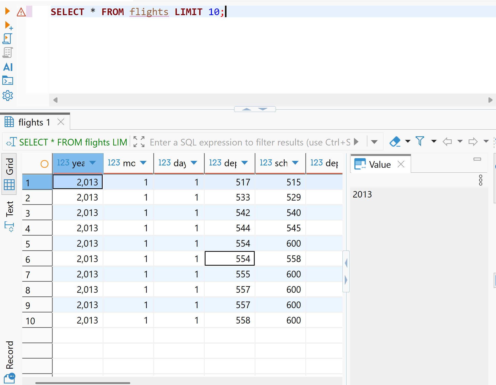
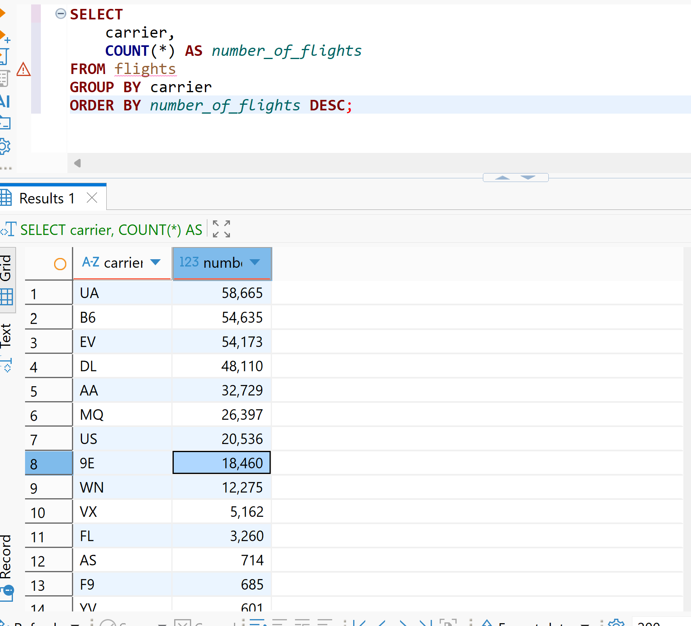
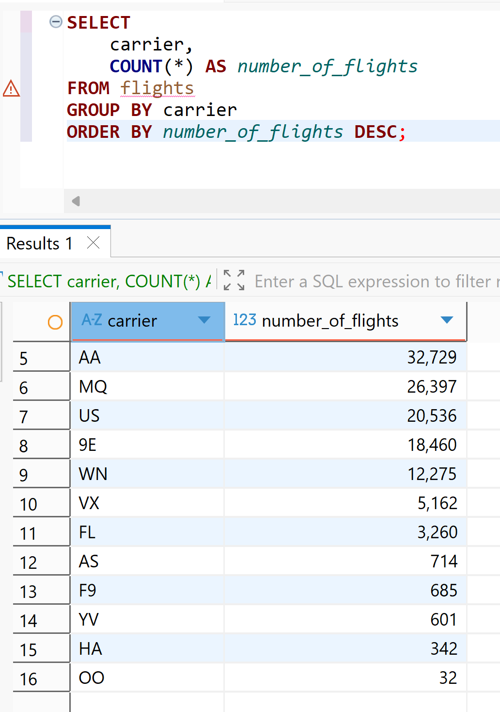
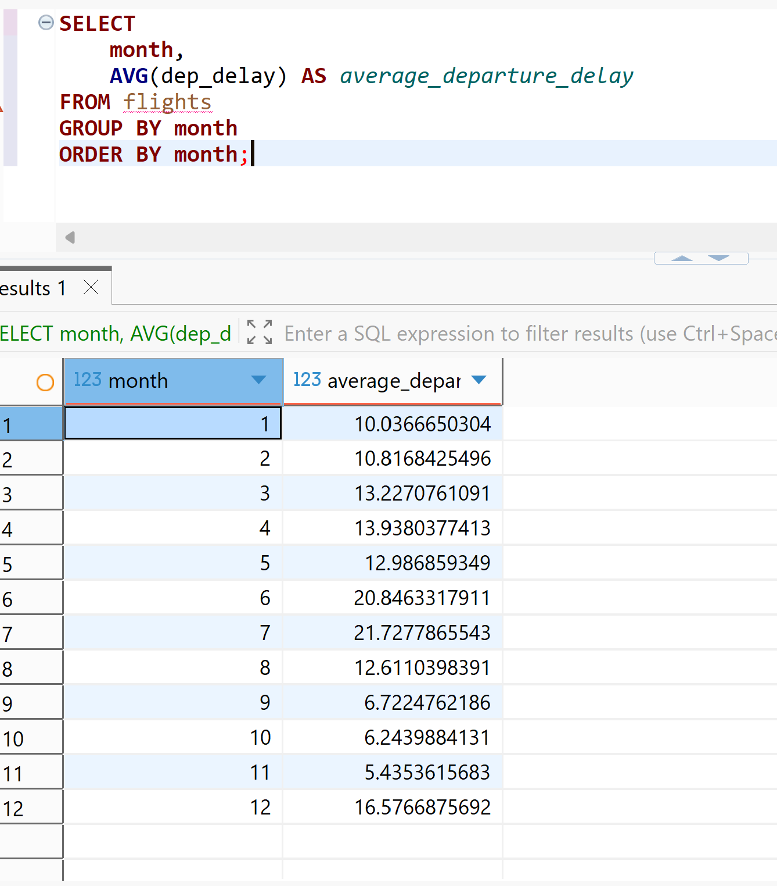
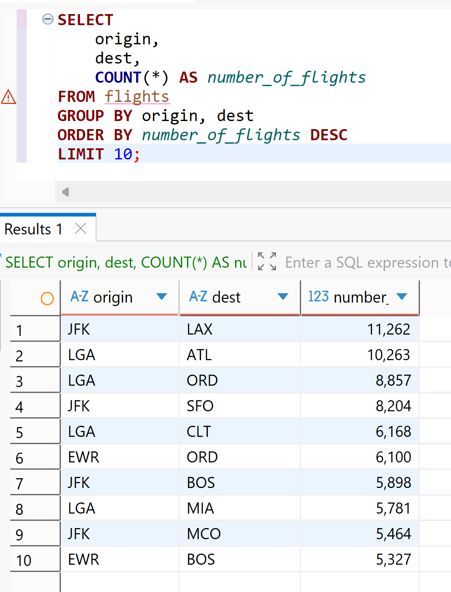

```{r setup, include=FALSE}
knitr::opts_chunk$set(echo       = TRUE, 
                      fig.align  = "center",
                      fig.height = 3, fig.width = 4)
ggplot2::theme_set(ggplot2::theme_bw() + ggplot2::theme(strip.background = ggplot2::element_rect(fill = "white")))
```

### Part I

#### a.

```{r}
library(DBI)
library(duckdb)

conn <- dbConnect(
  duckdb(),
  "C:/Users/Salme Adeele/Desktop/data413/flights.duckdb",
  read_only = TRUE
)
```

List the first **10 rows** of the `flights` table.

```{r}
dbGetQuery(conn, "
  SELECT *
  FROM flights
  LIMIT 10
")
```

#### b.

### Total number of flights

```{r}
dbGetQuery(conn, "
  SELECT COUNT(*) AS number_of_flights
  FROM flights
")
```

### Number of flights for each carrier

```{r}
dbGetQuery(conn, "
  SELECT carrier,
         COUNT(*) AS number_of_flights
  FROM flights
  GROUP BY carrier
  ORDER BY number_of_flights DESC
")
```

#### c.

Find the **average departure delay** (`dep_delay`)

```{r}
dbGetQuery(conn, "
  SELECT AVG(dep_delay) AS average_departure_delay
  FROM flights
")
```

#### d.

Find the **top 5 destinations** (`dest`) With the most flights.

```{r}
dbGetQuery(conn, "
  SELECT dest,
         COUNT(*) AS number_of_flights
  FROM flights
  GROUP BY dest
  ORDER BY number_of_flights DESC
  LIMIT 5
")
```

#### e.

Create a table showing:

- `carrier`

- average arrival delay (`arr_delay`)

Sort the results from **largest to smallest delay**

```{r}
dbGetQuery(conn, "
  SELECT carrier,
         AVG(arr_delay) AS average_arrival_delay
  FROM flights
  GROUP BY carrier
  ORDER BY average_arrival_delay DESC
")
```

```{r}
dbDisconnect(conn, shutdown = TRUE)
```

### Part II

#### a.

List the first **10 rows** of the `flights` table. 

#### b.

Count the Number of Flights for Each Carrier

Find the **number of flights** for each carrier.

- Your output should include:
  - carrier
  - number of flights Sort from the **largest to smallest**.

 

#### c.

Find the **average departure delayby month**

- Your output should include:
  - month
  - average departure delay



#### d.

Find the **top 10 routes** (`dest`) by:

- `origin`

- `dest`

ordered by **number of flights**.



#### e.

Export the result of part b query to a **CSV file** using the **Export Data** feature in DBeaver.
